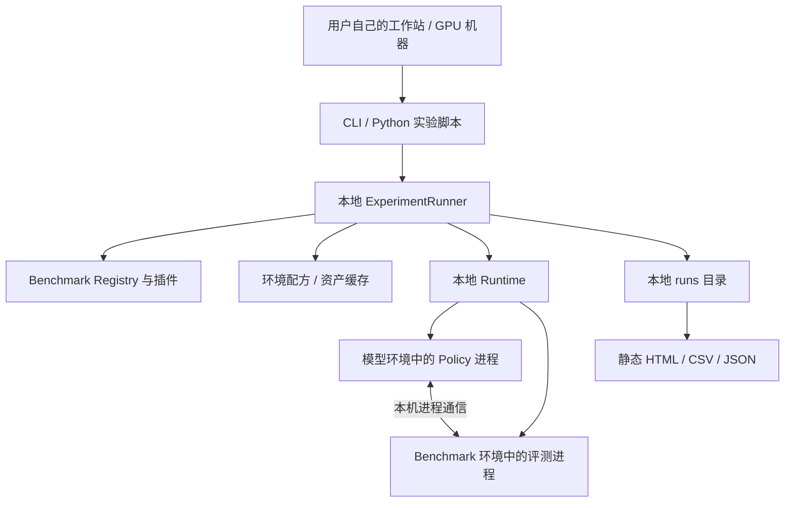

# 本地技术架构

## 技术栈

| 层 | 选择 | 作用与边界 |
| --- | --- | --- |
| 编排核心 | Python 3.11、Pydantic v2 | 配置校验、解析实验计划、类型化结果；不导入模型框架或 simulator |
| CLI | Typer、Rich、PyYAML | 本机命令入口、进度与诊断；直接调用 Python runner |
| 执行 | 已实现本机子进程，Docker 运行能力按配方逐步接入 | 使用用户已有的独立 Python 环境，benchmark 长期优先交付经验证的 Docker 配方 |
| GPU 容器支持 | Docker Engine、NVIDIA Container Toolkit | 用户机器满足条件时使用；按插件实际支持范围检查 |
| 模型 SDK | NumPy、MessagePack、WebSocket | 模型与 benchmark 环境间通信；不依赖 PyTorch／JAX |
| 依赖管理 | uv；模型／simulator 可用自己的 uv／venv／Conda 环境 | 编排环境与模型、simulator 分离，不强行统一 Python／CUDA 版本 |
| 本地存储 | 文件系统、JSON／JSONL、YAML、NPZ | 配置、运行状态、索引和大文件；无数据库服务依赖 |
| 报告 | Jinja2 静态 HTML、内嵌图表、CSV／JSON | 浏览本地任务与视频、比较同 benchmark；不需要 Node 构建链 |
| 开发 | uv.lock、Ruff、pytest | 锁定工具包依赖，CPU 契约测试与显式 GPU 集成测试分开 |

MVP 不需要 FastAPI、中心数据库、服务端队列或 React 应用。编排包的 Python 版本不约束模型和 benchmark 环境。Native backend 指用户指定的隔离解释器，不是在编排进程内 import 所有框架。Docker backend 只支持已有验收配方，不承诺任意 simulator 可被通用镜像自动安装。

模型继续运行在宿主机的独立环境。首个 RoboDojo 配方先用宿主机 Conda 建立原生参考，再用同版本上游镜像验证 Docker 交付。GPU 驱动和容器运行权限由目标机器提供。[V05 开发计划](vibe-coding-plan.md#v05-robodojo-基线与对齐条件)

## 模块及职责



| 模块 | 输入 → 输出 | 为什么需要 |
| --- | --- | --- |
| CLI／Python API | 用户配置 → runner 调用 | 交互命令与研究脚本共用逻辑 |
| Schemas／Resolver | YAML、参数 → 固定版本的执行计划 | 统一路径、默认值、checkpoint 与资源选择，避免隐式配置 |
| Registry | benchmark 名称／配方 → 插件与清单 | 增量接入 benchmark，不修改核心分支 |
| Benchmark Plugin | 执行上下文 → 环境评测计划、原生结果 | 容纳环境、控制循环、评分和文件格式的真实差异 |
| SDK／Adapter Runtime | 原生 profile 观测 → 模型动作 | 使模型与 simulator 的依赖分离；语义转换由 adapter 显式完成 |
| Environment／Cache | 版本化配方／资产来源 → 可用环境与只读资产 | 复用下载与安装，减少相互污染 |
| Runtime | argv、环境、设备、目录 → 进程句柄与退出码 | 封装 native／Docker 启停，不处理任务语义 |
| ExperimentRunner | 固定计划 → 各 eval 的执行与状态 | 按阶段编排、取消、故障分类与收集 |
| Storage／Results | 原生结果和事件 → 结果目录与索引 | 让未成功的运行也留下可分析证据 |
| Report／Compare | 结果目录 → 本地报告／对比表 | 不依赖在线服务即可查看和分享 |
| Optional Training | 用户训练入口 → 新 checkpoint 与训练记录 | 支持受控实验；未配置时完全跳过 |

工具包提供集成层，计算发生在用户的进程／容器中。SDK 中的 policy server 只是跨环境通信进程，不是维护者运营的模型服务。

## 目标目录

下面是目标结构。已实现的模块和当前验证状态见 [实施记录](implementation-status.md)。

```text
OpenPlatform/
├── pyproject.toml
├── uv.lock
├── src/openplatform/
│   ├── cli/                   # list/doctor/prepare/eval/run/status/report/compare
│   ├── schemas/               # ModelSpec/ExperimentSpec/ResolvedExperiment/Result
│   ├── runner/                # resolver、阶段编排、取消、attempt
│   ├── registry/              # 插件发现与 profile/recipe 解析
│   ├── runtime/               # NativeRuntime、DockerRuntime、资源与进程清理
│   ├── cache/                 # 下载、摘要、文件锁、环境准备
│   ├── storage/               # 本地状态、原子写入与产物索引
│   ├── results/               # 原生指标公共外壳与 episode 数据
│   ├── report/                # 静态模板、比较、CSV/JSON
│   └── training/              # 后置可选执行，不是 eval 的必要依赖
├── sdk/src/openplatform_sdk/
│   ├── adapter.py             # 四方法协议
│   ├── server.py              # 模型环境中的轻量进程
│   ├── client.py              # benchmark 端调用
│   ├── codec.py               # 数组编码、消息大小校验
│   ├── trace.py               # 轨迹与事件写入
│   └── bridges/               # 可复用模型／既有接口模板
├── benchmarks/<benchmark>/
│   ├── benchmark.yaml
│   ├── plugin.py              # 不依赖 simulator 的轻量插件
│   ├── runner/                # 在 benchmark 环境执行原生包装
│   ├── profiles/              # 观测／动作语义与控制参数
│   ├── envs/                  # 环境锁或隔离安装配方
│   ├── docker/                # 已验证时提供
│   ├── assets.lock.json
│   ├── fixtures/
│   └── README.md
├── runtime-recipes/            # 模型环境配方，独立于 benchmark
├── examples/{submissions,benchmarks}/
├── tests/{unit,contracts,integration}/
├── scripts/                   # 研究对照实验与复现辅助
├── docs/
└── runs/                      # 本地结果，不入 Git
```

权重、simulator 大资产、环境目录、缓存和结果均不入 Git。SDK 可单独装进用户模型环境，不要求安装编排工具的全部依赖。

## 本地运行与恢复

一个 Experiment 包含多个 Eval，每个 Eval 对应明确的 benchmark、checkpoint、参数和尝试记录。默认按配置顺序执行，一个 policy 进程同时只处理一个 episode。

```text
pending → preparing → [training] → starting_policy → evaluating → collecting → succeeded
任意执行阶段 → 尽力 collecting → failed / canceled / interrupted
```

根状态按各 eval 汇总为 succeeded、partially_succeeded、failed、canceled 或 interrupted。SIGINT／超时后终止本次创建的子进程或容器，保留日志与已完成 episode。状态使用临时文件加原子替换，不依赖后台 worker。`status` 读取本地记录，活跃状态需结合本机进程存活检查；进程消失应标记 interrupted。

首版重新执行命令创建新 run，旧产物不覆盖；每个 eval 的初始 attempt 为 0001，为以后显式重试预留结构。首版不承诺恢复到半个 episode 的物理状态；episode 级续跑仅在插件明确保证重置与聚合正确时开放。下载可做有界重试；训练、评测和动作调用不自动重复执行以掩盖错误。并发和实验室调度器适配后置。

## 环境、资源与路径

Native 模式将解析后的宿主绝对路径传给子进程；容器模式映射为 `/model`、`/checkpoint`、`/adapter`、`/assets`、可选 `/data` 和可写 `/outputs`。Adapter 读取注入的 `checkpoint_path`，不把容器路径写死。用户已有环境由其维护，工具包记录解释器与包列表；托管于本机缓存的配方环境记录锁文件和版本。

Policy 与 simulator 可以使用不同 Python／框架／CUDA 用户态依赖，但共享宿主驱动约束。Native 通信默认 loopback；跨容器采用本次运行的私有网络及显式端点，不向公网暴露。脚本用 argv 执行，不默认拼接 shell。

GPU 由用户显式选择。共享同卡仅在相应配方通过显存和渲染验证时开放；资源声明不是显存硬隔离。缓存文件锁与设备占用检查只能协调本工具包的协作进程，不能替代集群调度器。各插件列出已验证平台和最低实测资源，不能把设计配置当硬件测试结论。CPU／Mac 可用于契约测试和报告，GPU simulator 以实际支持矩阵为准。

## 文件与缓存

默认结果根为命令执行目录的 `runs/`；缓存根为 `~/.cache/openplatform/`，均可覆盖。输入模型默认原地引用，不复制或上传大权重。解析时固定来源 revision，准备后记录资产摘要和环境版本；本地源码、adapter、配置保存快照，权重记录摘要与路径。发生输入变化后需生成新计划，不能把旧摘要套在新内容上。

结果目录保存状态、解析后的配置、环境信息、原生指标和产物。复现包默认只包含配置／代码快照／摘要与结果，不自动包含权重、完整图像或需许可资产；报告列明缺失材料与获取方式。源路径记录有助定位，但不能取代模型的可获取版本。
