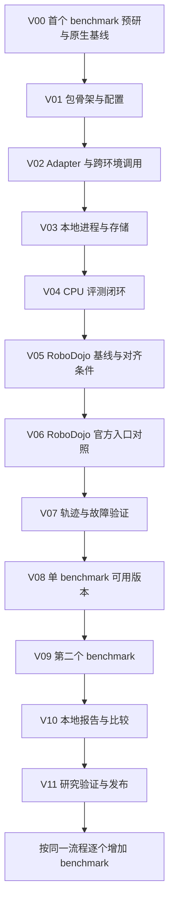

# Vibe coding 开发执行计划

本计划把 [开发任务](development-tasks.md) 转换为可以逐轮交给编码 agent 的工作单元。交付目标是用户克隆后在自有机器运行的具身评测研究工具包：model + adapter → benchmark eval → 本地指标、轨迹、视频和报告。Training 后置。

按迭代验收和归档。V05、V06 分别记录 CPU 准备与 GPU 验收，CPU 工作可以在 GPU 证据待采集时推进。当前进度见 [实施记录](implementation-status.md)。

## 开发顺序

先查清一个真实 benchmark 的调用边界，再用假环境做通工程链路，尽早回到真实仿真验证。第二个 benchmark 应早于复杂展示功能，用于发现接口设计是否过度依赖第一个环境。



V01 至 V04 的本机 CPU 验收见 [实施记录](implementation-status.md)。长期按 benchmark 交付 Docker 配方，模型使用独立的宿主机环境。V05 依次验证 RoboDojo 官方入口的宿主机 Conda 配方和同版本上游 Docker 镜像。V06 将 OpenPlatform 与官方入口配对。版本对齐、配方、bridge 和离线对照可先在 Mac 上开发，真实仿真证据在受支持的 Linux RTX 机器采集。[官方入口对照协议](integrations/robodojo-comparison.md)

## 迭代总表

每行是一个可审查的工作单元，不代表一次提示一定完成。涉及 simulator 安装与调试时，可以在同一编号下继续修复，直到满足验收。

| 迭代 | 对应任务 | 可见交付物 | 验收环境 |
| --- | --- | --- | --- |
| V00 | T08 前置 | 上游版本、原生启动命令、I/O 与环境边界、参考 policy、资源条件 | 源码调查；原生运行需自有 GPU |
| V01 | T01 | 可安装的编排包／SDK 骨架、配置解析、CLI 帮助、必要开发约定 | CPU |
| V02 | T03 | 四方法 adapter、codec、独立 policy 进程与 client | CPU，两个隔离 Python 环境 |
| V03 | T02、T04 部分 | NativeRuntime、日志、取消、run 目录、原子状态写入 | CPU |
| V04 | T05 至 T07 最小实现 | 假 benchmark 插件、runner、eval／run／status／list 闭环 | CPU |
| V05 | T04、T08 部分 | Conda 官方基线、同版本上游 Docker smoke 与版本记录 | Mac 准备，Linux RTX 验收 |
| V06 | T08 | 原生控制循环 bridge、无权重及 π0 官方入口对照、逐 episode 证据 | CPU 契约检查，Linux RTX 验收 |
| V07 | T09 | 实际动作轨迹、policy 调用记录、错误分类、采集开销证据 | CPU fixture + 自有 GPU |
| V08 | 单 benchmark 验收 | 从新 clone 到结果的文档和复现记录 | 干净环境、自有 GPU |
| V09 | T11 | 第二个 benchmark 插件与兼容性修订 | 自有 GPU |
| V10 | T10、T12 | 静态报告、同协议比较、复现材料导出 | 已有结果即可，CPU |
| V11 | T13 | 研究实验脚本、测量结果、限制和发布材料 | CPU + 自有 GPU；跨机器实验需两台机器 |
| 后续 | B03 起、T14 | 每次一个新 benchmark；训练执行另行增加 | 按新增能力决定 |

## 人与编码 agent 的分工

研究者负责选择研究问题、确认 benchmark 范围、提供可运行的参考 checkpoint 与可用机器，并判断控制语义与实验协议是否正确。Agent 负责查阅上游、实现、运行获授权的检查、诊断和整理证据。模型／资产访问条件或机器权限缺失时，agent 说明具体缺项并继续不依赖它的工作。

最值得人工检查的是四个边界：输入状态与图像含义、动作的单位／坐标／绝对或增量约定、控制频率与 chunk 执行策略、原生评分与终止条件。代码能跑通不代表这些语义正确。

一次迭代使用一个聚焦的对话和一组可审查变更。开始前查看工作区现有修改，保留用户工作；完成后做一个独立提交或等价变更快照。不要求同时启动多个 agent。遇到接口问题先缩小到能复现的样例，再修复，不用不断扩大提示要求 agent 重写全仓库。

## 每轮使用的提示模板

将下面模板与对应迭代任务一起交给编码 agent。已经完成的能力以代码与验证记录为准，不仅依据对话记忆。

```text
请执行 docs/vibe-coding-plan.md 中的 Vxx。

先阅读适用的 AGENTS.md、README、该迭代及相关接口文档，检查实际代码和现有修改。
只实现该迭代需要的最小能力；必要的接口调整同步说明原因和影响。
保持本地运行、用户自备算力、model + adapter、training 可选、benchmark 插件化的边界。
不要加入在线服务、中心队列、账号系统、自动 SFT 或尚无真实用例的抽象。
涉及第三方 benchmark 时核实官方源码／文档，固定 revision；不要猜入口、参数或数据链接。
实现后运行能检验本轮行为的检查。GPU／依赖／权限缺失时，区分已验证和未验证部分。
最后报告：变更、验证命令及结果、已知限制、下一轮所需输入，并更新开发记录。
完成本轮验收后停止，不自动开始下一迭代。
```

开发记录建议在 V01 创建 `docs/implementation-status.md`，每轮仅追加／更新必要信息：迭代编号、状态、代码版本、运行命令、证据路径、限制和下一步。状态为未开始、进行中、受阻、已验收；受阻写明具体条件。配置、日志与结果文件是验收依据，不使用“应该可以运行”代替证据。

## V00 首个 benchmark 的事实调查

**目标：** 先确定真实集成边界。首选 RoboDojo，初始范围为 ARX X5 joint 控制下的 `stack_bowls`。固定版本、源码入口和接口对照见调查记录。

**交付：** [RoboDojo 原生评测调查](integrations/robodojo-discovery.md)。源码调查已验收，GPU 原生 smoke 待验证。

先记录官方入口能否独立运行。有自有 GPU 时执行原生 smoke 并保存日志和原始结果；没有时记录待执行命令，不编造成功。若上游不可获得，说明具体阻塞并从候选表选择可验证的首个 benchmark，相应调整后续名称。

**给 agent 的任务：**

```text
执行 V00。先核实 RoboDojo 官方源码与文档，并固定上游版本。
产出真实调用链、I/O 语义、参考 policy、环境／资产条件和最小原生运行步骤。
检查现有接口草案与上游是否冲突。此轮不实现框架，不猜测缺失参数；
有可用机器则运行原生 smoke，否则明确待验证项并给出可执行步骤。
```

**验收：** 读者能定位上游代码并理解如何接入。开始 V06 真机对照前，在 V05 归档原生运行证据。若官方参考模型与 SDK 不同，记录 bridge 需求，不能直接假定兼容。

## V01 包骨架与配置

**目标：** 建立真正可安装、可校验的最小仓库，不生成整套空目录。

实现 `pyproject.toml`、编排包和独立 SDK 包的最小安装方式、锁文件、Ruff 与 CPU CI。实现当前 eval-only 必要的 ModelSpec、ExperimentSpec、RuntimeSpec 与结果外壳；`openplatform --help` 可用。若创建 `AGENTS.md`，只记录本仓库开发边界与真实检查命令，保持简短。

Checkpoint／模型路径相对规则、eval ID 唯一、suite 与 preset 互斥、未知字段和参数错误应明确。训练执行尚未支持时，对训练配置返回清楚的 unsupported 提示；训练背景元数据仍可保存，不必提前实现训练器。

**给 agent 的任务：**

```text
执行 V01。实现最小 Python 包、CLI 帮助、eval-only 配置 schema 和开发检查。
复用现有示例，并提供可在临时目录构造输入的配置契约检查。
区分 schema 校验与文件存在性／运行条件检查；不要在读取 YAML 时启动环境或模型。
不实现 runtime、Web、Docker 编排或训练。记录实际安装与检查命令。
```

**验收：** 本地可安装；CLI 帮助可用；纯 eval 示例通过结构校验，错误配置被拒绝。包含尚未支持的可选 training 执行时明确报错，而非静默忽略。

## V02 Adapter 与跨环境调用

**目标：** 独立模型环境能被调用，框架不依赖 PyTorch 或 JAX。

实现四方法协议、注入配置、版本握手、WebSocket／MessagePack codec、client 和 policy 入口。用确定性 toy policy 验证 reset、观测、动作 chunk 与异常行为。一个进程只承载一个 active episode。

**给 agent 的任务：**

```text
执行 V02。实现 SDK 的最小跨进程调用，并用 toy adapter 跑完整调用序列。
覆盖数组 dtype／shape、调用异常、超时及 episode reset；不要自动重试有状态调用。
用两个独立 Python 环境验证 SDK 能单独安装，且无需装模型框架或编排包全量依赖。
只使用 CPU，不做 GPU 推理优化或批处理。
```

**验收：** client 得到预期数组与动作顺序；非法消息、版本不匹配、模型异常可定位；测试结束后不残留 policy 进程和监听端口。

## V03 本地进程与结果存储

**目标：** 可靠启动和关闭本次任务，并保存证据。

实现 NativeRuntime 的 argv 执行、指定解释器、cwd／env、stdout／stderr、超时和进程组清理。实现唯一 run ID、配置快照、原子状态、相对产物索引与最小摘要能力。复杂下载缓存留到 V05 的真实资产需求，不先做对象存储框架。

**给 agent 的任务：**

```text
执行 V03。实现 NativeRuntime 和最小本地 run 存储。
用临时子进程验证正常退出、非零退出、超时、显式取消及其派生进程清理。
验证重复运行不覆盖旧结果，异常后保留日志；不杀死不属于本次任务的进程。
暂不实现 Docker；若 V00 证明首个 benchmark 必须用 Docker，在 V05 再补具体需求。
```

**验收：** 退出与取消行为明确；日志和状态一致；未运行完的目录能识别为 interrupted。资源清理检查针对本次创建的进程，不靠大范围 kill。

## V04 CPU 评测闭环

**目标：** 第一次完整演示“模型声明 → 插件 → 评测 → 本地结果”。

增加开发用 dummy benchmark，提供至少两个短 episode、确定性评分和可控运行错误。实现 Registry、Plugin、Resolver、顺序 ExperimentRunner，以及 list／eval／run／status 的必要能力。Dummy 清楚标为开发 fixture，不列成真实具身 benchmark 支持。

**给 agent 的任务：**

```text
执行 V04。用 V02 的独立 policy 进程和 V03 的 runtime 跑 dummy benchmark。
提供独立于真实模型的 CPU 示例配置，完成 CLI 与 Python API 两条入口。
验证任务不成功仍是正常 eval；推理／环境错误是运行失败；多 eval 失败后继续，取消后停止。
保存 resolved config、原始结果、公共指标和日志。不在 runner 中写 benchmark 名称分支。
```

**验收：** 从非仓库工作目录执行仍能找到已配置的插件和资源；一个命令生成结果目录；任务失败与系统错误的状态和退出码不同；core 仍不 import simulator 或模型框架。

**首个里程碑：** V04 之后已经有可运行的 CPU 工程骨架。此时回到真实 benchmark，避免继续堆积报告、缓存和调度功能。

## V05 RoboDojo 基线与对齐条件

目标是验证 RoboDojo 的两种环境配方，给 V06 留下原生参考和可复用的容器。固定 `stack_bowls`、ARX X5 joint、seed 0、单环境和无权重 `demo_policy`，两次 smoke 各请求一个有效 episode。

**现在在 Mac 上做。** 准备轻量 manifest、`doctor` 和 `prepare` 的计划与缓存检查。把 V00 的 Conda 安装步骤和同一提交的上游 Docker 构建／启动命令写成两份配方，固定子模块、资产 revision 和参数。用临时目录及小型 fixture 验证路径解析、生成的只读挂载参数、结果目录和缺失资源诊断。核对 shell 语法、命令参数和版本表，归档可执行的 Linux 命令、CPU 检查结果和 GPU 待验收项。

**在 Linux RTX 上验收。** 先执行 V00 的 Conda 原生 smoke，再用同一 RoboDojo 提交和资产构建上游镜像，运行其 `docker/smoke_docker.sh run`。分别归档退出码、实际 `layout_id`、有效 episode 数、原生 JSON、视频和日志。容器另查 GPU 可见性、相机渲染、宿主机 policy 连接、挂载与结果可读性，记录镜像 ID、构建参数及冷热启动耗时。两份官方配方的证据供 V06 配对复用。[V05 执行命令](integrations/robodojo-v05/README.md)

V05 用上游脚本验收容器，OpenPlatform 可先沿用 `NativeRuntime`。Docker smoke 通过后，将已验证的镜像构建／复用步骤接到该 benchmark 的 `prepare`。容器启动先按 RoboDojo 的实际需求实现，通用后端在后续 benchmark 提供可复用场景时抽象。

**给 agent 的任务：**

```text
执行 V05，阅读 V00 调查和 docs/integrations/robodojo-comparison.md。
在 Mac 上准备 RoboDojo manifest、doctor、prepare 计划、Conda 与 Docker 配方。
固定上游源码、子模块和资产，检查命令、挂载、缓存及缺失依赖诊断。
在 Linux RTX 上依次运行 Conda 官方 demo 和同版本上游 Docker demo。
分别归档实际布局、有效 episode、日志、原始结果和视频，并记录镜像与依赖。
按 CPU 准备和 GPU 实跑分别更新状态，交付本轮证据后停止。
```

验收分两档。CPU 准备通过需要可审查的配方、版本记录、命令和 fixture 结果。GPU 环境通过需要 Conda 与 Docker 均完成有效 episode 并产出可核对的原生结果和视频。遇到 Docker 权限、构建或渲染问题，保留已有 Conda 证据并记录容器待验收项。

## V06 RoboDojo 官方入口对照

目标是让用户通过本地 model 与 adapter 运行 RoboDojo，并以 benchmark 官方入口为唯一实测基线。使用 V05 的版本表与运行配方。插件的 bridge 从原生 `EvalEnv` 构造时接入，保留初次 reset、`deploy.py` 控制循环、动作执行、终止和计分。用 V02 的 SDK 与 V04 的 runner 启动和收集。

按 [官方入口对照协议](integrations/robodojo-comparison.md) 依次跑 CPU 契约检查、无权重双路 smoke，以及同一发布 π0 checkpoint 的双路对照。用户在 OpenPlatform 只切换本地提交配置。保留两路原始产物，并按实际布局生成逐 episode 对照与首个可观测差异。完成 smoke 后，再跑预先声明的任务范围。

V05 的 Conda 与 Docker 产物是同一官方入口在两种环境下的证据。OpenPlatform 可以先用同一宿主机 Conda 配方接通 bridge 并做第一组配对。容器路径通过 GPU、通信和产物验收后，优先使用同一已验收的仿真镜像基础重复配对，记录派生镜像与生效依赖。只能用不同配方运行时，报告两路结果与环境差异，归因范围限于整条配方。

**给 agent 的任务：**

```text
执行 V06，按 docs/integrations/robodojo-comparison.md 接入 RoboDojo。
在插件内接入 bridge 和结果收集，保留原生控制与评分。
先用 CPU fixture 检查双 reset、观测映射、动作顺序与 chunk 截断。
在 Linux RTX 上依次做官方入口与 OpenPlatform 的无权重 smoke、同一 π0 checkpoint 对照。
匹配两路 Conda 环境或仿真镜像基础及生效依赖，归档实际对齐状态。
按实际 layout_id 对齐，保存原始结果、调用与执行动作、终止和计分证据。
标明不可比项，记录首个可观测差异；按实测范围更新验收状态。
```

验收交付为 RoboDojo 插件、无权重和 π0 提交示例、两路配置及证据包。CPU 契约检查与真实运行分别标记。只有两路均完成且配对条件成立的组进入受控比较，差异和随机波动按实测报告。容器配方正式交付前，额外确认 OpenPlatform 的 policy 握手、退出清理和结果文件可读。

## V07 轨迹与故障验证

**目标：** 结果能用于研究分析，而不止报告一个成功率。

在真实执行处记录已执行动作、可获得的 state、仿真 step、policy call ID、chunk 索引、视频帧索引和时间。原始输出 chunk 与真正执行的动作分开。完整观测图像默认不保存，按配置开启。

**给 agent 的任务：**

```text
执行 V07。把轨迹写入钩子放到真实动作执行边界，关联 policy 调用与视频帧。
验证 chunk 部分执行后终止的情况，不能把未执行动作写成已执行轨迹。
测试模型异常、仿真中断和取消，保留完成项与错误信息；原生评分分母保持不变。
对相同实验比较采集关闭／开启的行为和开销，标记环境不支持的字段。
```

**验收：** 能从一个 episode 找到其实际动作、调用和视频对应；缺失字段标为 unavailable。采集不偷偷改变动作执行长度、控制频率或任务协议。

## V08 单 benchmark 可用版本

**目标：** 不依赖开发者当前终端状态，也能按说明复现。

用新 clone／干净环境验证安装、SDK 安装、doctor、prepare、smoke 和完整范围；权重、资产与依赖的获取方法均明确。发布范围以 clone 后运行工具包为主，不为独立 PyPI 分发所有 simulator 提前建设复杂打包系统。

**给 agent 的任务：**

```text
执行 V08。按新用户路径运行，不依赖未记录的 PYTHONPATH、cwd、手工改包或全局依赖。
补齐从 clone 到结果的 README、模型 adapter 示例和支持矩阵；同步命令真实实现状态。
CPU CI 不联网下载大权重或启动 GPU 仿真；GPU 验收单独提供明确命令和结果记录。
只修复阻碍这一流程的问题，不扩展新的 benchmark 或展示系统。
```

**验收：** 一位未参与开发的人能沿文档跑通 smoke，并知道完整评测的资源成本与启动方式。没有可用第三方复现者时先做开发者干净环境验收，外部复现保持待完成。

## V09 第二个 benchmark

**目标：** 用 LIBERO 检验通用接口，而不是复制首个 benchmark 的工程。

沿 V00、V05 至 V08 的流程完成独立插件，先一个 suite。可以使用不同 checkpoint 和 adapter_config；工具包不宣称同一个 base 已适应两个环境。共享模型加载逻辑，保留各自语义转换。

**给 agent 的任务：**

```text
执行 V09，逐步核实并接入 LIBERO 的一个固定 suite。
优先通过插件、profile、配方和 adapter 配置表达差异，不在核心按名称分支。
若真实需求暴露接口不足，给出具体两个用例，作最小契约修订并重跑第一个插件的相关检查。
记录新增插件代码、核心修改和接入工作量，保留原生对照证据。
```

**验收：** 同一工具包能独立运行两个 benchmark；不同 checkpoint 在报告中可辨认；首个插件不回归。接口修订有真实差异依据，不要求核心永远零修改。

## V10 本地报告与比较

**目标：** 从已有结果离线生成可读材料，不增加在线系统。

生成静态 HTML、CSV／JSON、任务切片、错误列表和产物链接。按 benchmark／suite／protocol 分组，展示 checkpoint 与训练背景；不兼容的实验明确标注。导出复现材料列出未包含的权重与需许可资产。

**给 agent 的任务：**

```text
执行 V10。只读取已有结果生成 report／compare，不启动模型、simulator 或下载依赖。
先完成指标表、episode 明细、版本信息、视频／轨迹链接和错误展示，使用静态模板。
增加缺失产物和部分完成实验的展示；不实现 React、账号、榜单或业务 API。
验证将结果目录移动后，相对产物链接仍有效。
```

**验收：** 报告不依赖原机器的数据库、绝对路径或在线服务；指标与原始结果一致；复现材料的可获取范围明确。

## V11 研究验证与发布

**目标：** 用实验说明工具包解决了哪些工程问题，为研究贡献提供证据。

依据 [T13](development-tasks.md) 扩展 V06 官方入口对照，执行采集开销、接入成本、跨机器复现和分析可用性实验。接入成本从 V00 起记录，区分人工操作时间、agent／脚本等待时间与 GPU 运行时间。

**给 agent 的任务：**

```text
执行 V11。把 T13 的研究实验转成可重复运行的脚本和结果表，固定对照条件。
利用已记录的开发与运行数据，公开原始测量及协议差异；缺失实验保留待完成。
整理当前支持的版本、已知限制和复现步骤，不预先填写提升比例或声称未测硬件兼容。
自动化脚本先验证小规模范围，再由使用者在自有机器执行声明的实验规模。
```

**验收：** 第三方能按命令重复已报告实验；收益、成本与限制可追溯。若只完成单机器结果，研究结论限于该范围。

## 后续扩展

新增 benchmark 复用 V00、V05 至 V09 的流程，每次只做一个插件。Training 继续后置；在确有受控训练实验需求时单独执行 T14，不因希望“看起来完整”而加入。

以下功能等真实需求出现再评估：批量推理、同机并发、共享内存通信、集群调度器、第三方插件分发和 episode 续跑。性能优化必须先有延迟或资源测量，不能凭直觉替换整个通信栈。

## 本轮验收与交接格式

每个迭代完成后，agent 用下列格式交接，下一轮从记录继续。

```text
迭代：Vxx
状态：已验收／进行中／受阻
本轮可见行为：
相关文件和代码版本：
验证命令与实际结果：
日志／结果／轨迹路径：
未验证项与具体原因：
接口变更及兼容影响：
下一轮所需输入：
```

检查应覆盖本轮真实新增或修复的行为，不追求只会复述实现的测试数量。CPU 假环境、schema 检查和 mock policy 只能证明工程契约；真实 benchmark、驱动／渲染兼容性、模型控制能力与性能都需要对应环境的执行证据。
